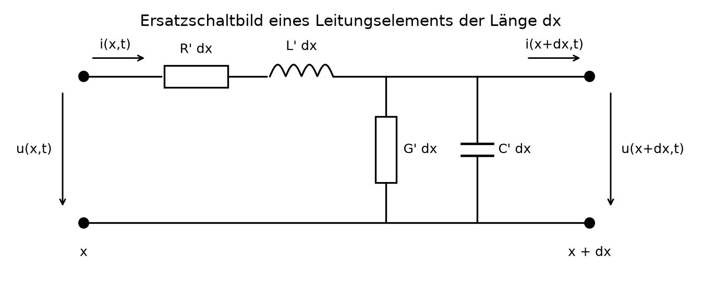
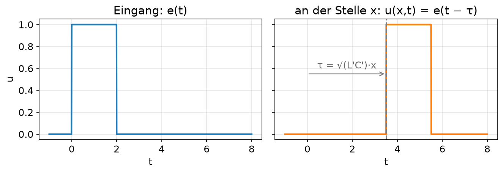
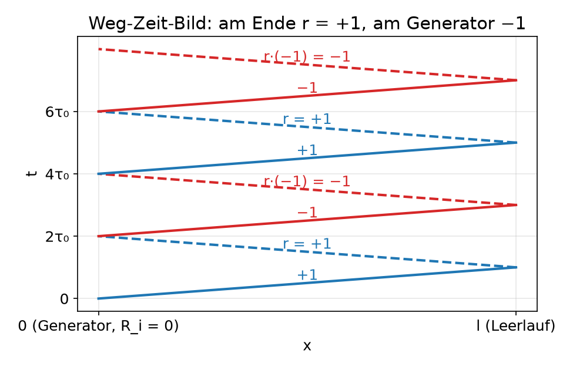
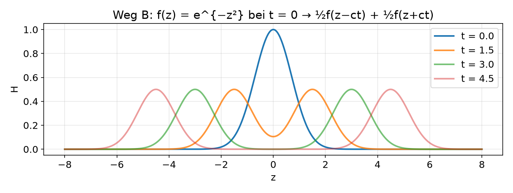
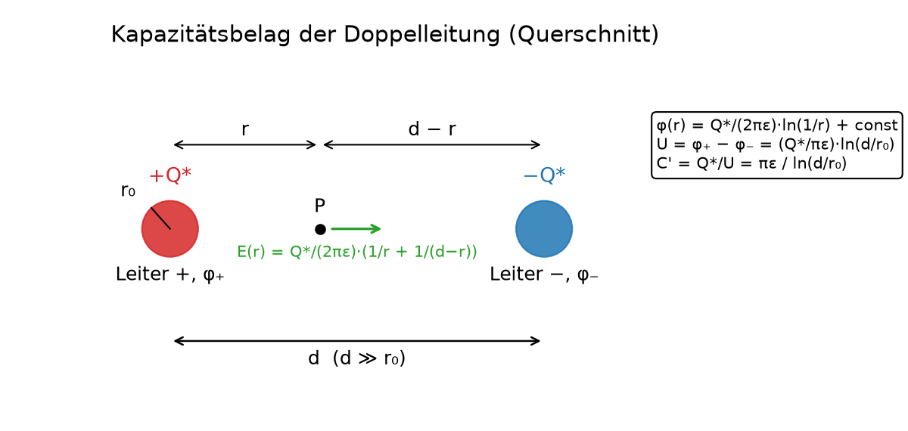
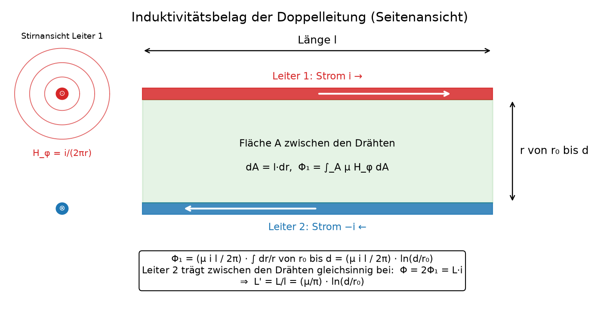
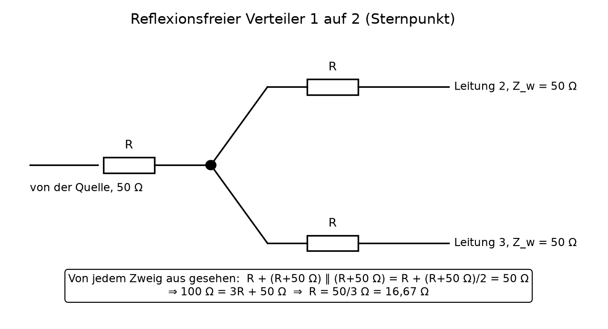
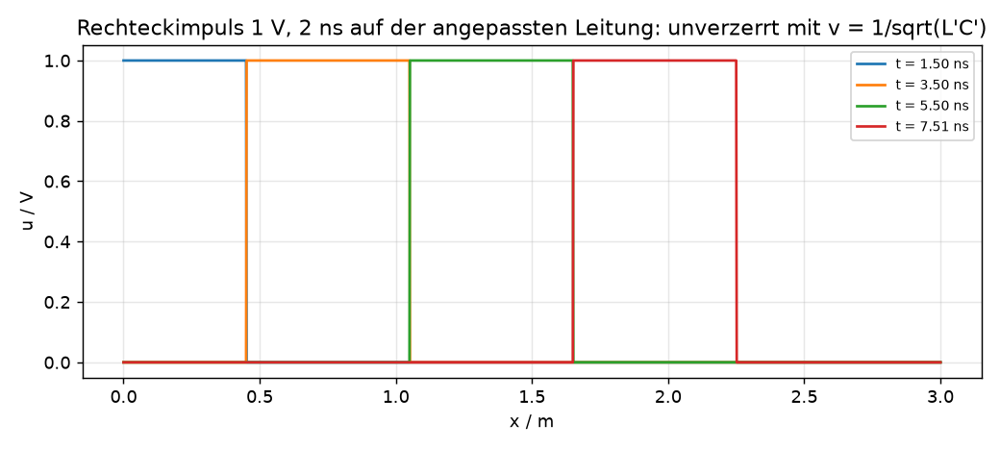
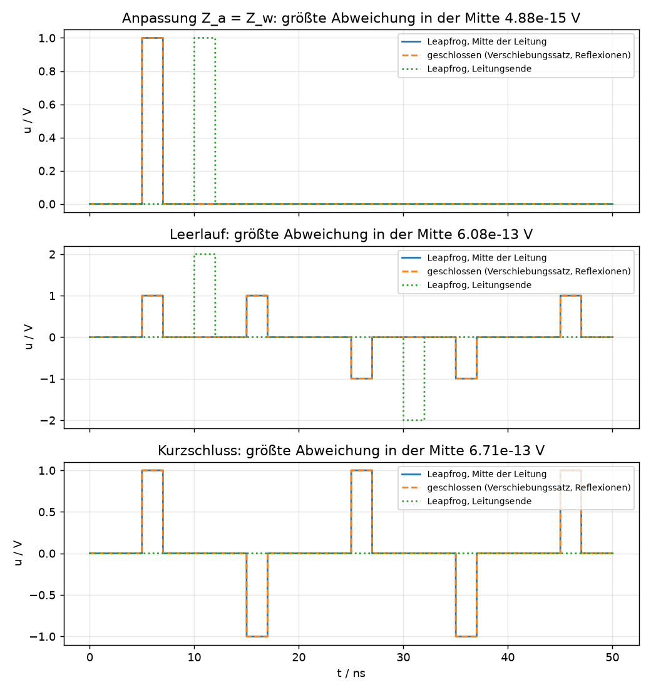

# Worum es geht

Ein Rechteckimpuls wird auf eine Doppelleitung gegeben. Was kommt wann am anderen Ende an, und warum
in derselben Form? Dieses Manuskript führt die Antwort von den Maxwellschen Gleichungen bis zur
Zahl, auf zwei voneinander unabhängigen Wegen, die sauber getrennt bleiben:

- **Weg A** (Vorlesung): Die Leitung wird als Kette von Vierpolen aufgefasst. Daraus folgen die
  Leitungsgleichungen; die Laplace-Transformation **in der Zeit** macht sie zu gewöhnlichen
  Differentialgleichungen im Ort. Für die verlustlose, angepasste Leitung liefert der
  **Verschiebungssatz** das Ergebnis: Die Leitung ist ein ideales Laufzeitglied.
- **Weg B** (zweiter, unabhängiger Ansatz): Die Wellengleichung selbst wird **doppelt**
  Laplace-transformiert, in Zeit *und* Ort. Übrig bleibt eine algebraische Gleichung; die
  Rücktransformation liefert von selbst die d'Alembert-Lösung, zwei gegenläufige Wellen.
- **Die Beläge** der Doppelleitung (Kapazität, Induktivität je Länge) werden aus den Feldern
  hergeleitet; mit ihnen wird der Wellenwiderstand, der in Weg A als Abkürzung entsteht, zur Zahl.

Alle Zwischenschritte stehen im Text. Jede Gleichung wurde mit einem CAS-Skript (sympy) nachgerechnet,
der Impuls zusätzlich numerisch im Zeitbereich (Abschnitt 8). Was im Text als Annahme eingeht, ist als
Annahme bezeichnet.

**Bezeichnungen.** $u(x,t)$ Spannung, $i(x,t)$ Strom an der Stelle $x$ zur Zeit $t$; Beläge je
Länge $R'$ (Widerstand), $L'$ (Induktivität), $G'$ (Ableitung), $C'$ (Kapazität); Laplace-Variable
$s$ für die Zeit, $p$ für den Ort; $\mathcal{L}\{f(t)\} = F(s) = \int_0^\infty f(t)\,e^{-st}\,dt$.
Transformierte tragen Großbuchstaben oder einen Querstrich.

# Von den Maxwellschen Gleichungen zur Wellengleichung

## Die Gleichungen

In differentieller Form, mit den Materialgleichungen $\mathbf D = \varepsilon \mathbf E$, $\mathbf B = \mu \mathbf H$,
$\mathbf j = \sigma \mathbf E$ (lineares, homogenes, isotropes Medium):

$$\operatorname{div}\mathbf D = \rho,\qquad
  \operatorname{rot}\mathbf E = -\frac{\partial \mathbf B}{\partial t},\qquad
  \operatorname{rot}\mathbf H = \mathbf j + \frac{\partial \mathbf D}{\partial t},\qquad
  \operatorname{div}\mathbf B = 0. \tag{1.1}$$

## Hochfrequenznäherung

Bei schnellen Vorgängen überwiegt der Verschiebungsstrom den Leitungsstrom:
$\left|\partial \mathbf D/\partial t\right| \gg |\mathbf j|$, bei harmonischer Zeitabhängigkeit
$\omega\varepsilon/\sigma \gg 1$. Damit entfällt $\mathbf j$ im Durchflutungsgesetz, und ohne freie
Ladungen ($\rho = 0$) bleibt

$$\operatorname{div}\mathbf E = 0,\qquad
  \operatorname{rot}\mathbf E = -\mu\frac{\partial \mathbf H}{\partial t},\qquad
  \operatorname{rot}\mathbf H = \varepsilon\frac{\partial \mathbf E}{\partial t}. \tag{1.2}$$

## Rotation der Rotation

**Die Vektoridentität.** Für ein zweimal stetig differenzierbares Vektorfeld $\mathbf E = (E_x, E_y, E_z)$ gilt

$$\operatorname{rot}\operatorname{rot}\mathbf E = \operatorname{grad}\operatorname{div}\mathbf E - \Delta\mathbf E, \tag{1.3a}$$

wobei $\Delta\mathbf E$ komponentenweise zu lesen ist. Man sieht es an der $x$-Komponente (die anderen folgen
durch zyklisches Vertauschen). Die Rotation hat die Komponenten

$$\operatorname{rot}\mathbf E = \left(\partial_y E_z - \partial_z E_y,\;\;
\partial_z E_x - \partial_x E_z,\;\; \partial_x E_y - \partial_y E_x\right),$$

also ist

$$(\operatorname{rot}\operatorname{rot}\mathbf E)_x
  = \partial_y(\operatorname{rot}\mathbf E)_z - \partial_z(\operatorname{rot}\mathbf E)_y
  = \partial_y(\partial_x E_y - \partial_y E_x) - \partial_z(\partial_z E_x - \partial_x E_z).$$

Ausmultipliziert und um $\partial_x^2 E_x$ ergänzt (einmal addiert, einmal subtrahiert):

$$(\operatorname{rot}\operatorname{rot}\mathbf E)_x
  = \partial_x\partial_y E_y + \partial_x\partial_z E_z - \partial_y^2 E_x - \partial_z^2 E_x
  \;+\; \partial_x^2 E_x - \partial_x^2 E_x$$
$$\phantom{(\operatorname{rot}\operatorname{rot}\mathbf E)_x}
  = \partial_x\left(\partial_x E_x + \partial_y E_y + \partial_z E_z\right)
  - \left(\partial_x^2 + \partial_y^2 + \partial_z^2\right)E_x,$$

also $(\operatorname{rot}\operatorname{rot}\mathbf E)_x = \partial_x(\operatorname{div}\mathbf E) - \Delta E_x$, was (1.3a) ist.
(Das CAS-Skript prüft die Identität für ein allgemeines Feld in allen drei Komponenten.)

**Einsetzen der Feldgleichungen.** Man bildet die Rotation des Induktionsgesetzes
$\operatorname{rot}\mathbf E = -\mu\,\partial\mathbf H/\partial t$ auf beiden Seiten. Weil Orts- und Zeitableitung bei
hinreichend glatten Feldern vertauschbar sind, darf $\operatorname{rot}$ an $\partial/\partial t$ vorbei:

$$\operatorname{rot}\operatorname{rot}\mathbf E
  = \operatorname{rot}\left(-\mu\,\frac{\partial \mathbf H}{\partial t}\right)
  = -\mu\,\frac{\partial}{\partial t}\operatorname{rot}\mathbf H. \tag{1.3b}$$

Jetzt das Durchflutungsgesetz in der Hochfrequenznäherung, $\operatorname{rot}\mathbf H = \varepsilon\,\partial\mathbf E/\partial t$:

$$\operatorname{rot}\operatorname{rot}\mathbf E
  = -\mu\,\frac{\partial}{\partial t}\left(\varepsilon\,\frac{\partial \mathbf E}{\partial t}\right)
  = -\mu\varepsilon\,\frac{\partial^2 \mathbf E}{\partial t^2}. \tag{1.3c}$$

**Gleichsetzen.** Die linke Seite von (1.3c) ist nach (1.3a) $\operatorname{grad}\operatorname{div}\mathbf E - \Delta\mathbf E$,
und $\operatorname{div}\mathbf E = \rho/\varepsilon$ (Gaußsches Gesetz mit $\mathbf D = \varepsilon\mathbf E$). Das ergibt die
Gleichung in der Form der Vorlesung (Folie 11/12):

$$\operatorname{grad}\left(\frac{\rho}{\varepsilon}\right) - \Delta\mathbf E = -\mu\varepsilon\,\frac{\partial^2 \mathbf E}{\partial t^2}. \tag{1.3d}$$

Ohne freie Ladungen, $\rho = 0$, fällt der Gradiententerm weg, und nach Multiplikation mit $-1$ bleibt die
**Wellengleichung**

$$\boxed{\;\Delta\mathbf E - \mu\varepsilon\,\frac{\partial^2 \mathbf E}{\partial t^2} = 0\;},\qquad
  c = \frac{1}{\sqrt{\mu\varepsilon}}. \tag{1.4}$$

**Dasselbe für $\mathbf H$.** Rotation des Durchflutungsgesetzes:
$\operatorname{rot}\operatorname{rot}\mathbf H = \varepsilon\,\partial_t\operatorname{rot}\mathbf E = -\mu\varepsilon\,\partial_t^2\mathbf H$;
mit (1.3a) und $\operatorname{div}\mathbf H = \operatorname{div}\mathbf B/\mu = 0$ (hier ohne jede Annahme über Ladungen)
folgt $\Delta\mathbf H - \mu\varepsilon\,\partial_t^2\mathbf H = 0$, dieselbe Gleichung.

Bei harmonischer Zeitabhängigkeit $\partial^2/\partial t^2 \to -\omega^2$ entsteht die Helmholtz-Form
$\Delta\mathbf E + k^2\mathbf E = 0$ mit $k^2 = \mu\varepsilon\omega^2$; sie wird hier nicht weiter verwendet,
weil wir **keine harmonische Welle, sondern einen Impuls** untersuchen.

## Der eindimensionale Fall

Hängt das Feld nur von einer Koordinate $z$ ab (ebene Welle, oder das Feld zwischen den Leitern einer
Leitung längs der Leitungsachse), bleibt für jede Feldkomponente, etwa $H_x$,

$$\frac{\partial^2 H_x}{\partial z^2} - \frac{1}{c^2}\,\frac{\partial^2 H_x}{\partial t^2} = 0. \tag{1.5}$$

Diese Gleichung ist der Ausgangspunkt von Weg B. Weg A geht nicht vom Feld, sondern von Spannung und
Strom auf der Leitung aus und kommt auf eine Gleichung derselben Gestalt.

# Weg A, Teil 1: Die Leitung als Vierpolkette

## Das Ersatzschaltbild des Leitungselements

Ein Leitungsstück der Länge $dx$ hat den Längswiderstand $R'\,dx$, die Längsinduktivität $L'\,dx$,
die Querableitung $G'\,dx$ und die Querkapazität $C'\,dx$ (Bild: Längszweig $R'\,dx$, $L'\,dx$,
dann Querzweig $G'\,dx \parallel C'\,dx$, dann die Klemmen bei $x+dx$).

{width=85%}

**Maschensatz** über den Längszweig:

$$u(x,t) = R'\,dx\;i + L'\,dx\;\frac{\partial i}{\partial t} + u(x+dx,t). \tag{2.1}$$

Umgestellt und durch $dx$ geteilt:

$$\frac{u(x+dx,t)-u(x,t)}{dx} = -R'\,i - L'\,\frac{\partial i}{\partial t}, \tag{2.2}$$

und für $dx \to 0$

$$\boxed{\;\frac{\partial u}{\partial x} = -R'\,i - L'\,\frac{\partial i}{\partial t}\;} \tag{2.3}$$

**Knotensatz** am Querzweig (der Strom, der in den Querzweig fließt, fehlt am Ausgang):

$$i(x,t) = G'\,dx\;u + C'\,dx\;\frac{\partial u}{\partial t} + i(x+dx,t), \tag{2.4}$$

$$\frac{i(x+dx,t)-i(x,t)}{dx} = -G'\,u - C'\,\frac{\partial u}{\partial t}, \tag{2.5}$$

$$\boxed{\;\frac{\partial i}{\partial x} = -G'\,u - C'\,\frac{\partial u}{\partial t}\;} \tag{2.6}$$

(2.3) und (2.6) sind die **Leitungsgleichungen** (in der Vorlesung Gln. 4.27 und 4.30). Dabei ist die
Spannung im Querzweig $u(x+dx,t)$ statt $u(x,t)$ angesetzt; der Unterschied ist von zweiter Ordnung in
$dx$ und verschwindet im Grenzübergang.

## Die Telegraphengleichung im Zeitbereich

Leitet man (2.3) nach $x$ ab und setzt (2.6) ein,

$$\frac{\partial^2 u}{\partial x^2} = -R'\,\frac{\partial i}{\partial x} - L'\,\frac{\partial}{\partial t}\frac{\partial i}{\partial x}
  = -R'\left(-G'u - C'\frac{\partial u}{\partial t}\right) - L'\frac{\partial}{\partial t}\left(-G'u - C'\frac{\partial u}{\partial t}\right),$$

so entsteht die **Telegraphengleichung**

$$\boxed{\;\frac{\partial^2 u}{\partial x^2} = L'C'\,\frac{\partial^2 u}{\partial t^2} + (R'C' + L'G')\,\frac{\partial u}{\partial t} + R'G'\,u\;} \tag{2.7}$$

Für $R' = G' = 0$ ist das genau die Wellengleichung (1.5) mit $1/c^2 = L'C'$. Dieselbe Gleichung
gilt für $i$. Die Beziehung zu den Feldern (Abschnitt 6) macht aus der Analogie eine Identität:
$L'C' = \mu\varepsilon$.

# Weg A, Teil 2: Laplace in der Zeit und der Verschiebungssatz

## Transformation in der Zeit

Für beliebige Eingangssignale ist die Laplace-Transformation in $t$ das Werkzeug der Wahl. Mit dem
Ableitungssatz $\mathcal{L}\{\partial f/\partial t\} = sF - f(x,0)$ wird aus (2.3) und (2.6)

$$\frac{dU}{dx} = -(R' + sL')\,I + L'\,i(x,0),\qquad
  \frac{dI}{dx} = -(G' + sC')\,U + C'\,u(x,0). \tag{3.1}$$

Wir betrachten den **energielosen Anfangszustand**: $u(x,0) = 0$, $i(x,0) = 0$ für alle $x$. Dann

$$\frac{dU}{dx} = -(R' + sL')\,I,\qquad \frac{dI}{dx} = -(G' + sC')\,U. \tag{3.2}$$

Das sind gewöhnliche Differentialgleichungen im Ort; $s$ ist ein Parameter. Angenommen wird außerdem
eine **homogene** Leitung: $R', L', G', C'$ hängen nicht von $x$ ab.

## Nebenrechnung 1: Elimination des Stroms

Aus der ersten Gleichung (3.2): $I = -\dfrac{1}{R'+sL'}\dfrac{dU}{dx}$. Nach $x$ abgeleitet und in die
zweite eingesetzt:

$$\frac{dI}{dx} = -\frac{1}{R'+sL'}\frac{d^2U}{dx^2} = -(G'+sC')\,U
  \quad\Longrightarrow\quad
  \boxed{\;\frac{d^2U}{dx^2} = (R'+sL')(G'+sC')\,U\;} \tag{3.3}$$

Mit der Abkürzung (Fortpflanzungs- oder Ausbreitungskonstante)

$$\gamma = \sqrt{(R'+sL')(G'+sC')} \tag{3.4}$$

lautet (3.3)

$$\frac{d^2U}{dx^2} - \gamma^2 U = 0. \tag{3.5}$$

## Nebenrechnung 2: Exponentialansatz

Ansatz $U = e^{\lambda x}$: $\lambda^2 e^{\lambda x} - \gamma^2 e^{\lambda x} = 0$, also

$$\lambda^2 - \gamma^2 = 0 \quad\Longrightarrow\quad \lambda = \pm\gamma. \tag{3.6}$$

Die allgemeine Lösung von (3.5) ist deshalb

$$U(x) = K_1\,e^{-\gamma x} + K_2\,e^{\gamma x}. \tag{3.7}$$

## Nebenrechnung 3: Der Strom

Aus (3.2) mit (3.7):

$$I = -\frac{1}{R'+sL'}\,\frac{dU}{dx}
  = -\frac{1}{R'+sL'}\left(-K_1\gamma\,e^{-\gamma x} + K_2\gamma\,e^{\gamma x}\right)
  = \frac{\gamma}{R'+sL'}\left(K_1 e^{-\gamma x} - K_2 e^{\gamma x}\right).$$

Mit $\gamma/(R'+sL') = \sqrt{(R'+sL')(G'+sC')}/(R'+sL') = \sqrt{(G'+sC')/(R'+sL')}$ folgt

$$I(x) = K_1\sqrt{\frac{G'+sC'}{R'+sL'}}\,e^{-\gamma x} - K_2\sqrt{\frac{G'+sC'}{R'+sL'}}\,e^{\gamma x}. \tag{3.8}$$

Die Wurzel ist der Kehrwert einer Größe von der Dimension eines Widerstands. Man nennt

$$\boxed{\;Z_w = \sqrt{\frac{R'+sL'}{G'+sC'}}\;} \tag{3.9}$$

den **Wellenwiderstand** der Leitung und schreibt die Lösung der Leitungsgleichungen als

$$U(x) = K_1 e^{-\gamma x} + K_2 e^{\gamma x},\qquad
  I(x) = \frac{K_1}{Z_w}\,e^{-\gamma x} - \frac{K_2}{Z_w}\,e^{\gamma x}. \tag{3.10}$$

$K_1$ und $K_2$ sind in $x$ konstant, hängen aber im Allgemeinen von $s$ ab; sie folgen aus den
Randbedingungen. Der erste Summand ist die **hinlaufende**, der zweite die **rücklaufende** Welle.

## Die verlustlose Leitung

Bei Energie- und Nachrichtenleitungen hält man $R'$ und $G'$ klein. Idealisiert:

$$R' = 0,\qquad G' = 0. \tag{3.11}$$

**Nebenrechnung 4:** $\gamma = \sqrt{sL'\cdot sC'} = s\sqrt{L'C'}$ und $Z_w = \sqrt{sL'/(sC')} = \sqrt{L'/C'}$. Also

$$U = K_1 e^{-s\sqrt{L'C'}\,x} + K_2 e^{s\sqrt{L'C'}\,x},\qquad Z_w = \sqrt{\frac{L'}{C'}}, \tag{3.12a}$$
$$I = \frac{K_1}{Z_w} e^{-s\sqrt{L'C'}\,x} - \frac{K_2}{Z_w} e^{s\sqrt{L'C'}\,x}. \tag{3.12b}$$

$Z_w$ ist jetzt **reell** und von $s$ unabhängig; die Exponentialfunktionen sind reine
Verschiebungsoperatoren in $x$.

## Randbedingungen: Generator mit $R_i = 0$, Abschluss $Z_a = Z_w$

Die Leitung der Länge $l$ wird am Eingang von einer Quelle mit der Urspannung $e(t)$ (Innenwiderstand
null) gespeist und am Ende mit $Z_a = Z_w$ abgeschlossen; $e(t) = 0$ für $t < 0$. Im Bildbereich mit
$E(s) = \mathcal{L}\{e(t)\}$:

$$U(0) = E,\qquad U(l) = Z_w\,I(l). \tag{3.13}$$

**Nebenrechnung 5:** Einsetzen von (3.12a/b) in (3.13):

$$K_1 + K_2 = E, \tag{3.14}$$
$$K_1 e^{-s\sqrt{L'C'}\,l} + K_2 e^{s\sqrt{L'C'}\,l}
  = Z_w\left(\frac{K_1}{Z_w} e^{-s\sqrt{L'C'}\,l} - \frac{K_2}{Z_w} e^{s\sqrt{L'C'}\,l}\right), \tag{3.15a}$$
$$\text{also}\qquad K_1 e^{-s\sqrt{L'C'}\,l} + K_2 e^{s\sqrt{L'C'}\,l} = K_1 e^{-s\sqrt{L'C'}\,l} - K_2 e^{s\sqrt{L'C'}\,l}. \tag{3.15b}$$

Aus (3.15b) folgt $K_2 e^{s\sqrt{L'C'}\,l} = -K_2 e^{s\sqrt{L'C'}\,l}$, also

$$K_2 = 0,\qquad K_1 = E. \tag{3.16}$$

Die **rücklaufende Welle verschwindet**: Am angepassten Ende wird nichts reflektiert. Spannung und
Strom im Bildbereich:

$$U(x) = E(s)\,e^{-s\sqrt{L'C'}\,x},\qquad I(x) = \frac{E(s)}{Z_w}\,e^{-s\sqrt{L'C'}\,x}. \tag{3.17}$$

## Der Verschiebungssatz und der Impuls

Der Verschiebungssatz (Rechtsverschiebung im Zeitbereich) lautet

$$\mathcal{L}\{f(t-T)\,\sigma(t-T)\} = e^{-sT}\,F(s),\qquad T > 0, \tag{3.18}$$

mit der Sprungfunktion $\sigma$. In (3.17) steht genau diese Form mit $T = \tau(x) = \sqrt{L'C'}\,x$.
Die Rücktransformation ist deshalb ohne jede Tabelle möglich:

$$\boxed{\;u(x,t) = e\!\left(t - \sqrt{L'C'}\,x\right),\qquad
  i(x,t) = \frac{1}{Z_w}\,e\!\left(t - \sqrt{L'C'}\,x\right)\;} \tag{3.19}$$

Das Ergebnis besagt:

1. Der Spannungsverlauf an der Stelle $x$ ist der Verlauf der Urspannung, **verschoben um
   $\tau = \sqrt{L'C'}\,x$**, in unveränderter Form. Ein Rechteckimpuls der Dauer $T_p$ am Eingang
   erscheint bei $x$ als derselbe Rechteckimpuls, beginnend bei $t = \tau$.
2. Der Strom ist überall die Spannung geteilt durch $Z_w$.
3. Ein Zustand bewegt sich mit der Geschwindigkeit
   $$v = \frac{x}{\tau} = \frac{1}{\sqrt{L'C'}} \tag{3.20}$$
   über die Leitung.
4. Der Eingangswiderstand ist $Z_e = U(0)/I(0) = Z_w$, reell, unabhängig von $l$.

Die angepasste verlustlose Leitung ist also ein **ideales Laufzeitglied** mit der Totzeit
$\tau_0 = \sqrt{L'C'}\,l$; in der Schreibweise der Regelungstechnik $U(l) = E\,e^{-s\tau_0}$.

{width=90%}

## Fehlanpassung: Reflexionen als verschobene Impulse

Schließt man die Leitung mit einem beliebigen Widerstand $Z_a$ ab, lauten die Randbedingungen
$U(0) = E$, $U(l) = Z_a I(l)$. Dieselbe Rechnung wie in Nebenrechnung 5 liefert für das Verhältnis
von rück- zu hinlaufender Welle **am Ende** den Reflexionsfaktor

$$r = \frac{K_2\,e^{\gamma l}}{K_1\,e^{-\gamma l}} = \frac{Z_a - Z_w}{Z_a + Z_w}, \tag{3.21}$$

also $r = 0$ bei Anpassung, $r = +1$ im Leerlauf, $r = -1$ im Kurzschluss. Am Generator mit $R_i = 0$
wird mit $-1$ reflektiert (die Spannung ist dort eingeprägt). Jede Reflexion ist im Bildbereich ein
weiterer Faktor $e^{-s\tau}$ und ein Faktor $r$ bzw. $-1$; mit dem Verschiebungssatz ist der Verlauf an
der Stelle $x$ die Summe verzögerter, skalierter Kopien des Eingangsimpulses:

$$u(x,t) = e\!\left(t - \tfrac{x}{v}\right)
  + \sum_{n\ge 1} r^n(-1)^{n-1}\,e\!\left(t - \tfrac{2nl - x}{v}\right)
  + \sum_{n\ge 1} r^n(-1)^{n}\,e\!\left(t - \tfrac{2nl + x}{v}\right). \tag{3.22}$$

Am offenen Ende verdoppelt sich die Impulsspannung ($1 + r = 2$), am Kurzschluss wird sie null;
Abschnitt 8 zeigt beide Fälle gerechnet.

## Quelle mit Innenwiderstand

Hat der Generator den Innenwiderstand $R_i$, lautet die Randbedingung am Eingang $U(0) = E - R_i\,I(0)$.
Mit (3.12a/b) und $U(l) = Z_a I(l)$ folgt (CAS-Posten 25–27)

$$K_1 = \frac{Z_w}{R_i + Z_w}\,E\cdot\frac{1}{1 - r_q\,r_a\,e^{-2\gamma l}},\qquad
  K_2\,e^{\gamma l} = r_a\,K_1\,e^{-\gamma l},\qquad
  r_q = \frac{R_i - Z_w}{R_i + Z_w},\quad r_a = \frac{Z_a - Z_w}{Z_a + Z_w}. \tag{3.23}$$

Drei Dinge stecken darin: Der Impuls tritt mit dem **Spannungsteiler** $Z_w/(R_i + Z_w)$ in die Leitung
ein (die Leitung wirkt am Eingang wie der Widerstand $Z_w$); am Ende wird mit $r_a$, am Generator mit
$r_q$ reflektiert; und $1/(1 - r_q r_a e^{-2\gamma l}) = \sum_{n\ge 0}(r_q r_a)^n e^{-2n\gamma l}$ ist die
**geometrische Reihe** der Mehrfachreflexionen, jede um die doppelte Laufzeit $2\tau_0$ verzögert. Für die
verlustlose Leitung ($\gamma = s/v$) liefert der Verschiebungssatz Glied für Glied

$$\boxed{\;u(x,t) = \frac{Z_w}{R_i + Z_w}\sum_{n\ge 0}(r_q r_a)^n\left[\,e\!\left(t - \tfrac{2nl + x}{v}\right)
  + r_a\,e\!\left(t - \tfrac{2(n+1)l - x}{v}\right)\right]\;} \tag{3.24}$$

Für $R_i = 0$ ist $r_q = -1$ und (3.24) geht in (3.22) über; für $R_i = Z_w$ ist $r_q = 0$: Nur noch ein
Hin- und ein Rücklauf, danach ist Ruhe — die vom Ende reflektierte Welle wird im Generator
vollständig aufgenommen. Gleichung (3.24) ist die Rechenvorschrift der Simulation in der
Laborseite (Abschnitt 8).

{width=60%}

# Weg B: Die doppelte Laplace-Transformation der Wellengleichung

Dieser Weg ist vom Ersatzschaltbild unabhängig. Er beginnt bei der Wellengleichung (1.5) für eine
Feldkomponente, hier $H_x(z,t)$, und transformiert **beide** Variablen: $t \to s$ und $z \to p$,

$$\bar H(p,s) = \int_0^\infty\!\!\int_0^\infty H_x(z,t)\,e^{-pz}\,e^{-st}\,dt\,dz. \tag{4.1}$$

Beide Transformationen sind lineare Integrale und vertauschbar. Die Ableitungssätze liefern je Variable
die Anfangs- bzw. Randwerte:

$$\mathcal{L}_t\mathcal{L}_z\left\{\frac{\partial^2 H_x}{\partial t^2}\right\}
  = s^2\bar H(p,s) - s\,\hat H(p,0) - \hat H_t(p,0), \tag{4.2}$$
$$\mathcal{L}_t\mathcal{L}_z\left\{\frac{\partial^2 H_x}{\partial z^2}\right\}
  = p^2\bar H(p,s) - p\,\hat H(0,s) - \hat H_z(0,s). \tag{4.3}$$

Dabei bezeichnet $\hat H(p,0)$ die Ortstransformierte des Anfangsfeldes, $\hat H(0,s)$ die
Zeittransformierte des Randwerts bei $z = 0$, Indizes $t$, $z$ die Ableitungen.

## Fall 1: Quelle am Rand, Ruhe für $t<0$

Anfangswerte null ($H_x(z,0) = 0$, $\partial_t H_x(z,0) = 0$). Am Rand $z = 0$ sei der Verlauf
$H_x(0,t) = a(t)$ vorgegeben, $A(s) = \mathcal{L}\{a\}$. **Annahme** (so im zweiten Ansatz): die
Steigung am Rand verschwindet, $\partial_z H_x(0,t) = 0$. Einsetzen in (1.5):

$$\left(p^2\bar H - p\,A(s)\right) - \frac{s^2}{c^2}\bar H = 0
  \quad\Longrightarrow\quad
  \bar H(p,s)\left(p^2 - \frac{s^2}{c^2}\right) = p\,A(s), \tag{4.4}$$

$$\boxed{\;\bar H(p,s) = A(s)\,\frac{p}{p^2 - (s/c)^2}\;} \tag{4.5}$$

Aus der partiellen Differentialgleichung ist eine algebraische Gleichung geworden.

**Rücktransformation des Ortes** ($p \to z$): Aus der Tabelle $\mathcal{L}^{-1}\{p/(p^2 - a^2)\} = \cosh(az)$,
hier $a = s/c$:

$$\hat H(z,s) = A(s)\cosh\!\left(\frac{s}{c}z\right)
  = \frac{A(s)}{2}\,e^{-\frac{s}{c}z} + \frac{A(s)}{2}\,e^{+\frac{s}{c}z}. \tag{4.6}$$

**Rücktransformation der Zeit** ($s \to t$) mit dem Verschiebungssatz (3.18), angewandt auf
$e^{\mp sz/c}$:

$$\boxed{\;H_x(z,t) = \tfrac12\,a\!\left(t - \tfrac{z}{c}\right) + \tfrac12\,a\!\left(t + \tfrac{z}{c}\right)\;} \tag{4.7}$$

Das ist die **d'Alembert-Lösung**: Das Randsignal zerfällt in zwei halb so große Wellen, eine läuft
in $+z$-Richtung, eine in $-z$-Richtung, beide unverzerrt mit $c$. Die Superposition ist hier nicht
angesetzt, sondern entsteht aus dem Bruch in (4.5).

**Einordnung der Annahme.** Die Steigungsbedingung $\partial_z H_x(0,t) = 0$ ist eine Wahl, keine
Folgerung. Lässt man $\hat H_z(0,s)$ in (4.3) stehen, ist

$$\bar H(p,s) = \frac{p\,A(s) + \hat H_z(0,s)}{p^2 - (s/c)^2}.$$

Mit $\hat H_z(0,s) = -\dfrac{s}{c}A(s)$ wird daraus $\bar H = A(s)/(p + s/c)$, also allein die
**hinlaufende** Welle $H_x = a(t - z/c)$: das ist die Lösung für eine halbunendliche, nach rechts
abgeschlossene Anordnung (Weg A, Gl. 3.19, mit $c = 1/\sqrt{L'C'}$). Beide Wege stimmen überein, sobald
man am Rand dieselbe Bedingung stellt; der Term $a(t + z/c)$ in (4.7) gehört zu einer Welle, die von
rechts auf den Rand zuläuft und dort die Steigung aufhebt.

## Fall 2: Anfangsimpuls im Raum

Jetzt sei zur Zeit $t = 0$ ein räumlicher Impuls vorhanden, $H_x(z,0) = f(z)$, in Ruhe:
$\partial_t H_x(z,0) = 0$; die Randwerte bei $z = 0$ werden für das unendlich ausgedehnte Medium null
gesetzt. Transformation zuerst im Ort, dann in der Zeit:

$$p^2\,\hat H(p,t) = \frac{1}{c^2}\,\frac{\partial^2 \hat H(p,t)}{\partial t^2},\qquad
  p^2\bar H(p,s) = \frac{1}{c^2}\left(s^2\bar H(p,s) - s\,\hat f(p)\right). \tag{4.8}$$

Auflösen:

$$\bar H\left(\frac{s^2}{c^2} - p^2\right) = \frac{s}{c^2}\,\hat f(p)
  \quad\Longrightarrow\quad
  \boxed{\;\bar H(p,s) = \hat f(p)\,\frac{s}{s^2 - (cp)^2}\;} \tag{4.9}$$

**Zeit zurück:** $\mathcal{L}^{-1}\{s/(s^2 - a^2)\} = \cosh(at)$ mit $a = cp$:

$$\hat H(p,t) = \hat f(p)\cosh(cp\,t) = \tfrac12\hat f(p)\,e^{p(ct)} + \tfrac12\hat f(p)\,e^{-p(ct)}. \tag{4.10}$$

**Ort zurück** mit dem Verschiebungssatz im Ort, $\mathcal{L}_z^{-1}\{\hat f(p)e^{\mp p\,ct}\} = f(z \pm ct)$:

$$\boxed{\;H_x(z,t) = \tfrac12 f(z - ct) + \tfrac12 f(z + ct)\;} \tag{4.11}$$

Ein losgelassener Impuls zerfällt augenblicklich in zwei halb so große Impulse gleicher Form, die mit
$c$ auseinanderlaufen. Für den Gaußpuls $f(z) = e^{-z^2}$ heißt das
$H_x = \tfrac12 e^{-(z-ct)^2} + \tfrac12 e^{-(z+ct)^2}$; das CAS-Skript bestätigt, dass (4.11) die
Wellengleichung, die Anfangsform und die Anfangsruhe erfüllt. (Die Rücktransformation von
$e^{+p\,ct}\hat f(p)$ setzt voraus, dass $f(z+ct)$ für das halbseitige Ortsintegral definiert ist; für
einen im Innern liegenden, hinreichend weit vom Rand entfernten Puls ist das erfüllt.)

{width=90%}

## Was die beiden Wege trennt und was sie verbindet

| | Weg A | Weg B |
|---|---|---|
| Ausgangspunkt | Ersatzschaltbild, Leitungsgleichungen (2.3)/(2.6) | Wellengleichung (1.5) aus Maxwell |
| Transformiert | nur die Zeit | Zeit und Ort |
| Was übrig bleibt | gewöhnliche DGL im Ort, Exponentialansatz | algebraische Gleichung |
| Randbedingungen | $U(0)$, $U(l) = Z_a I(l)$ — Generator und Abschluss | Wert und Steigung bei $z = 0$ bzw. Anfangspuls |
| Ergebnis | $e(t - x/v)$, Reflexionen als Summe verzögerter Impulse | $\tfrac12 a(t \mp z/c)$, d'Alembert |
| Wellenwiderstand | entsteht als $\sqrt{L'/C'}$ | kommt nicht vor (nur ein Feld) |

Weg A liefert Spannung *und* Strom und damit $Z_w$ und die Anpassung; Weg B liefert den Beweis, dass
die Wellengleichung ohne jeden Ansatz zwei gegenläufige Wellen enthält. Beide benutzen den
Verschiebungssatz als letzten Schritt.

# Die Beläge der Doppelleitung

Zwei parallele Drähte mit Radius $r_0$ im Abstand $d \gg r_0$, Länge $l$, Medium $\varepsilon$, $\mu$.

## Kapazitätsbelag

{width=80%}

**Potential einer Linienladung.** Eine Linienladung $q$ (Ladung je Länge) hat nach dem Gaußschen
Gesetz im Abstand $r$ die Feldstärke $E(r) = q/(2\pi\varepsilon r)$; ihr Potential ist das Integral
$\varphi(r) = -\int E\,dr = \dfrac{q}{2\pi\varepsilon}\ln\dfrac{1}{r} + \text{const}$. Die Konstante ist für beide
Ladungen dieselbe und fällt in jeder Potentialdifferenz heraus.

**Potential auf den Leitern.** Am Rand des Leiters $+$ (Abstand $r_0$ von der eigenen Achse, Abstand $d$ von
der Achse des Leiters $-$, weil $d \gg r_0$) überlagern sich die Potentiale beider Ladungen:

$$\varphi_+ = \frac{Q^*}{2\pi\varepsilon}\ln\frac{1}{r_0} + \frac{-Q^*}{2\pi\varepsilon}\ln\frac{1}{d}
  = \frac{Q^*}{2\pi\varepsilon}\left(\ln\frac{1}{r_0} - \ln\frac{1}{d}\right)
  = \frac{Q^*}{2\pi\varepsilon}\ln\frac{d}{r_0}, \tag{5.1a}$$

denn $\ln(1/r_0) - \ln(1/d) = \ln d - \ln r_0 = \ln(d/r_0)$. Am Leiter $-$ vertauschen sich die Rollen
(eigene Ladung $-Q^*$ im Abstand $r_0$, fremde $+Q^*$ im Abstand $d$):

$$\varphi_- = \frac{-Q^*}{2\pi\varepsilon}\ln\frac{1}{r_0} + \frac{Q^*}{2\pi\varepsilon}\ln\frac{1}{d}
  = \frac{Q^*}{2\pi\varepsilon}\left(\ln\frac{1}{d} - \ln\frac{1}{r_0}\right)
  = \frac{Q^*}{2\pi\varepsilon}\ln\frac{r_0}{d} = -\varphi_+. \tag{5.1b}$$

**Spannung.** Die Spannung zwischen den Leitern ist die Potentialdifferenz. Mit
$\ln(r_0/d) = -\ln(d/r_0)$ wird aus der Differenz eine Summe:

$$U = \varphi_+ - \varphi_-
  = \frac{Q^*}{2\pi\varepsilon}\left(\ln\frac{d}{r_0} - \ln\frac{r_0}{d}\right)
  = \frac{Q^*}{2\pi\varepsilon}\left(\ln\frac{d}{r_0} + \ln\frac{d}{r_0}\right)
  = \frac{Q^*}{2\pi\varepsilon}\cdot 2\ln\frac{d}{r_0}
  = \frac{Q^*}{\pi\varepsilon}\ln\frac{d}{r_0}. \tag{5.2}$$

**Kapazitätsbelag.** Kapazität je Länge ist Ladung je Länge durch Spannung:

$$\boxed{\;C' = \frac{Q^*}{U} = \frac{Q^*}{\dfrac{Q^*}{\pi\varepsilon}\ln\dfrac{d}{r_0}} = \frac{\pi\varepsilon}{\ln(d/r_0)}\;} \tag{5.3}$$

(CAS-Posten „(5.1)", „(5.2)": die Logarithmenschritte sind einzeln nachgerechnet.)

**Unabhängige Gegenprobe über das Feld.** Statt der Potentiale summiert man die Feldstärken auf der
Verbindungslinie der Drahtachsen. Im Abstand $r$ von der Achse des Leiters $+$ (und $d - r$ von der des
Leiters $-$) zeigen beide Beiträge in dieselbe Richtung:

$$E(r) = \frac{Q^*}{2\pi\varepsilon}\left(\frac{1}{r} + \frac{1}{d - r}\right),\qquad
  U = \int_{r_0}^{d - r_0} E(r)\,dr
    = \frac{Q^*}{2\pi\varepsilon}\Big[\ln r - \ln(d - r)\Big]_{r_0}^{d - r_0}
    = \frac{Q^*}{\pi\varepsilon}\ln\frac{d - r_0}{r_0}. \tag{5.3a}$$

Also $C' = \pi\varepsilon/\ln\!\big((d - r_0)/r_0\big)$, was für $d \gg r_0$ in (5.3) übergeht. Die **exakte** Lösung
der Doppelleitung (Spiegelladungen liegen nicht in den Drahtachsen, sondern bei $\pm\sqrt{(d/2)^2 - r_0^2}$)
lautet $C' = \pi\varepsilon/\operatorname{arcosh}\!\big(d/(2r_0)\big)$; wegen
$\operatorname{arcosh}(x) = \ln\!\big(x + \sqrt{x^2 - 1}\big) \to \ln(2x)$ für große $x$ ist auch sie für
$d \gg r_0$ gleich (5.3). Für $d = 10$ mm, $r_0 = 0{,}5$ mm: $\ln(d/r_0) = 2{,}9957$, $\ln((d-r_0)/r_0) = 2{,}9444$,
$\operatorname{arcosh}(d/2r_0) = 2{,}9932$ — die Näherung (5.3) liegt 0,08 % neben der exakten Lösung
(CAS-Posten „Kapazitätsbelag unabhängig").

## Induktivitätsbelag

{width=85%}

Der Strom $i$ in Leiter 1 erzeugt im Abstand $r$ das Feld $H_\varphi = i/(2\pi r)$. Der Fluss durch
die Fläche zwischen den Drähten (Länge $l$, $dA = l\,dr$) ist

$$\Phi_1 = \int_A \mu H_\varphi\,dA = \frac{\mu\,i\,l}{2\pi}\int_{r_0}^{d}\frac{dr}{r}
  = \frac{\mu\,i\,l}{2\pi}\ln\frac{d}{r_0}. \tag{5.4}$$

Zwischen den Drähten addieren sich die Flüsse beider Leiter konstruktiv (außerhalb heben sie sich
teilweise auf): $\Phi = \Phi_1 + \Phi_2 = 2\Phi_1$. Mit $\Phi = L\,i$ und $L' = L/l$:

$$\boxed{\;L' = \frac{\mu}{\pi}\ln\frac{d}{r_0}\;} \tag{5.5}$$

Die exakte äußere Induktivität ist entsprechend $L' = (\mu/\pi)\operatorname{arcosh}\!\big(d/(2r_0)\big)$; der
innere Anteil $\mu/(4\pi)$ je Leiter (Feld im Drahtinnern) ist bei hohen Frequenzen durch die Stromverdrängung
unterdrückt und wird hier nicht mitgezählt. Das Produkt $L'C'$ ist in exakter wie in genäherter Form $\mu\varepsilon$.

## Wellenwiderstand und Geschwindigkeit

Mit (3.12a):

$$Z_w = \sqrt{\frac{L'}{C'}} = \sqrt{\frac{\mu}{\pi}\ln\frac{d}{r_0}\cdot\frac{\ln(d/r_0)}{\pi\varepsilon}}
  = \frac{1}{\pi}\sqrt{\frac{\mu}{\varepsilon}}\,\ln\frac{d}{r_0}, \tag{5.6}$$

$$v = \frac{1}{\sqrt{L'C'}} = \frac{1}{\sqrt{\dfrac{\mu}{\pi}\ln\dfrac{d}{r_0}\cdot\dfrac{\pi\varepsilon}{\ln(d/r_0)}}}
  = \frac{1}{\sqrt{\mu\varepsilon}} = c. \tag{5.7}$$

Die Geometrie kürzt sich aus der Geschwindigkeit heraus: Der Impuls läuft mit der
Lichtgeschwindigkeit des Mediums, gleichgültig wie dick die Drähte sind. Nur der Wellenwiderstand
hängt von $d/r_0$ ab. In Luft ($\sqrt{\mu_0/\varepsilon_0} = 376{,}73\ \Omega$) ist
$Z_w = 119{,}9\ \Omega\cdot\ln(d/r_0)$; für $d = 10$ mm, $r_0 = 0{,}5$ mm:

$$C' = 9{,}285\ \text{pF/m},\qquad L' = 1{,}198\ \mu\text{H/m},\qquad
  Z_w = 359{,}2\ \Omega,\qquad v = 2{,}998\cdot 10^8\ \text{m/s}. \tag{5.8}$$

Ein 3 m langes Stück hat die Laufzeit $\tau_0 = \sqrt{L'C'}\,l = 10{,}0$ ns.

# Anpassung an Stoßstellen

## Die Stoßstelle zweier Leitungen

Eine Welle läuft auf Leitung 1 (Wellenwiderstand $Z_1$, Geschwindigkeit $v_1$, Bereich $x < 0$) nach
rechts und trifft bei $x = 0$ auf Leitung 2 ($Z_2$, $v_2$, Bereich $x > 0$). Nach (3.12a/b) und dem
Verschiebungssatz besteht die Lösung auf jeder Leitung aus einer hin- und einer rücklaufenden Welle;
der Strom der rücklaufenden Welle trägt nach (3.12b) das Minuszeichen. Auf Leitung 2 läuft nichts
zurück, solange ihr Ende angepasst ist oder die dortige Reflexion noch unterwegs ist. Also:

$$u_1(x,t) = u_e\!\left(t - \tfrac{x}{v_1}\right) + u_r\!\left(t + \tfrac{x}{v_1}\right),\qquad
  i_1(x,t) = \frac{u_e\!\left(t - \tfrac{x}{v_1}\right) - u_r\!\left(t + \tfrac{x}{v_1}\right)}{Z_1}, \tag{6.1a}$$
$$u_2(x,t) = u_t\!\left(t - \tfrac{x}{v_2}\right),\qquad
  i_2(x,t) = \frac{u_t\!\left(t - \tfrac{x}{v_2}\right)}{Z_2}. \tag{6.1b}$$

$u_e$ ist der einlaufende Impuls (bekannt), $u_r$ der reflektierte und $u_t$ der durchgelassene
Impuls (gesucht). **An der Stoßstelle gelten die Kirchhoffschen Regeln:** Die Spannung ist stetig,
weil beide Leitungen am selben Klemmenpaar hängen, und der Strom ist stetig, weil kein Querzweig
abzweigt:

$$u_1(0,t) = u_2(0,t),\qquad i_1(0,t) = i_2(0,t). \tag{6.2}$$

Mit (6.1a/b) an der Stelle $x = 0$, alle Funktionen zur selben Zeit $t$ genommen und abgekürzt
$u_e \equiv u_e(t)$ usw., entsteht das **lineare Gleichungssystem** für die beiden Unbekannten $u_r$
und $u_t$:

$$\begin{aligned}
  u_e + u_r &= u_t, \\
  \frac{u_e - u_r}{Z_1} &= \frac{u_t}{Z_2}.
\end{aligned} \tag{6.3}$$

Nach Unbekannten geordnet, in Matrixform:

$$\begin{pmatrix} 1 & -1 \\[4pt] \dfrac{1}{Z_1} & \dfrac{1}{Z_2} \end{pmatrix}
  \begin{pmatrix} u_r \\[4pt] u_t \end{pmatrix}
  = \begin{pmatrix} -u_e \\[4pt] \dfrac{u_e}{Z_1} \end{pmatrix}. \tag{6.4}$$

**Lösung durch Einsetzen.** Aus der ersten Zeile $u_t = u_e + u_r$, in die zweite:

$$\frac{u_e - u_r}{Z_1} = \frac{u_e + u_r}{Z_2}
  \quad\Longrightarrow\quad Z_2 u_e - Z_2 u_r = Z_1 u_e + Z_1 u_r
  \quad\Longrightarrow\quad u_r\,(Z_1 + Z_2) = u_e\,(Z_2 - Z_1). \tag{6.5}$$

Damit sind Reflexions- und Durchlassfaktor

$$\boxed{\;r = \frac{u_r}{u_e} = \frac{Z_2 - Z_1}{Z_2 + Z_1},\qquad
  t = \frac{u_t}{u_e} = 1 + r = \frac{2Z_2}{Z_2 + Z_1}\;} \tag{6.6}$$

**Lösung mit der Cramerschen Regel** (Gegenprobe): Die Determinante von (6.4) ist
$D = \tfrac{1}{Z_2} + \tfrac{1}{Z_1} = \tfrac{Z_1 + Z_2}{Z_1 Z_2}$, und

$$u_r = \frac{1}{D}\begin{vmatrix} -u_e & -1 \\[2pt] \dfrac{u_e}{Z_1} & \dfrac{1}{Z_2}\end{vmatrix}
  = \frac{Z_1 Z_2}{Z_1 + Z_2}\left(-\frac{u_e}{Z_2} + \frac{u_e}{Z_1}\right)
  = u_e\,\frac{Z_2 - Z_1}{Z_1 + Z_2}, \tag{6.7a}$$
$$u_t = \frac{1}{D}\begin{vmatrix} 1 & -u_e \\[2pt] \dfrac{1}{Z_1} & \dfrac{u_e}{Z_1}\end{vmatrix}
  = \frac{Z_1 Z_2}{Z_1 + Z_2}\cdot\frac{2u_e}{Z_1}
  = u_e\,\frac{2Z_2}{Z_1 + Z_2}. \tag{6.7b}$$

**Proben.** $Z_2 = Z_1$: $r = 0$, $t = 1$, die Welle läuft unverändert weiter. $Z_2 \to \infty$
(Leerlauf): $r = 1$, $t = 2$, die Spannung verdoppelt sich wie in (3.22). $Z_2 = 0$ (Kurzschluss):
$r = -1$, $t = 0$. Ein Abschlusswiderstand $Z_a$ ist der Sonderfall, in dem „Leitung 2" ein
Widerstand ist, $i_2 = u_2/Z_a$: (6.6) geht in (3.21) über. Der durchgelassene Impuls behält seine
Form und Dauer; seine räumliche Länge ändert sich von $v_1 T$ auf $v_2 T$.

**Leistungsbilanz.** Mit $P = u^2/Z$ für jede laufende Welle ist $P_e = u_e^2/Z_1$,
$P_r = u_r^2/Z_1$, $P_t = u_t^2/Z_2$, und

$$\frac{P_r + P_t}{P_e} = r^2 + t^2\,\frac{Z_1}{Z_2}
  = \frac{(Z_2 - Z_1)^2 + 4Z_1 Z_2}{(Z_1 + Z_2)^2} = \frac{(Z_1 + Z_2)^2}{(Z_1 + Z_2)^2} = 1. \tag{6.8}$$

Die Stoßstelle selbst verbraucht nichts; was nicht weiterläuft, läuft zurück.

## Verzweigung: eine Leitung speist mehrere

Gehen von der Stoßstelle $n - 1$ Leitungen mit $Z_2, \dots, Z_n$ ab, liegen sie alle am selben
Knoten. Die Spannung ist für alle dieselbe, $u_k(0,t) = u_t$, der Strom teilt sich auf:

$$u_e + u_r = u_t,\qquad
  \frac{u_e - u_r}{Z_1} = \sum_{k=2}^{n}\frac{u_t}{Z_k} = \frac{u_t}{Z_p},\qquad
  \frac{1}{Z_p} = \sum_{k=2}^{n}\frac{1}{Z_k}. \tag{6.9}$$

Das ist (6.3) mit $Z_2 \to Z_p$ (Parallelschaltung der abgehenden Leitungen), also

$$r = \frac{Z_p - Z_1}{Z_p + Z_1},\qquad t = \frac{2Z_p}{Z_p + Z_1}. \tag{6.10}$$

*Beispiel:* Eine 50-$\Omega$-Leitung speist zwei 50-$\Omega$-Leitungen: $Z_p = 25\ \Omega$,
$r = -\tfrac13$, $t = \tfrac23$. Ein Drittel der Spannung läuft mit umgekehrtem Vorzeichen
zurück; von der Leistung geht $r^2 = \tfrac19$ zurück und je $t^2 Z_1/Z_k = \tfrac49$ in jede
abgehende Leitung, zusammen $\tfrac19 + \tfrac89 = 1$.

**Verlustfreie Anpassung:** Bekommen die $n - 1$ abgehenden Leitungen je $Z_k = (n-1)Z_1$, ist
$Z_p = Z_1$ und $r = 0$, $t = 1$: Die ganze Leistung läuft weiter. Bei Leiterbahnen legt die Geometrie
(Bahnbreite über der Massefläche) den Wellenwiderstand fest; eine 50-$\Omega$-Zuleitung auf drei
Bahnen zu je 150 $\Omega$ ist so angepasst. Der Übergang von 50 auf 150 $\Omega$ in der Zuleitung
selbst muss dann stetig sein, siehe unten.

## Reflexionsfreier Sternpunkt mit Widerständen

Sollen die abgehenden Leitungen denselben Wellenwiderstand $Z$ behalten wie die speisende, legt man
in jeden der $n$ Zweige einen Widerstand $R$ zum Sternpunkt S (Bild). Von jedem Zweig aus muss die
Anordnung wie $Z$ aussehen. **Das Gleichungssystem** für die einlaufende Welle $u_e$ auf Leitung 1,
mit den Unbekannten $u_r$, $u_1$, $i_1$ (Leitungsende 1), $u_S$ (Sternpunkt), $i_k$, $u_k$
($k = 2, \dots, n$, nur hinlaufende Wellen auf den abgehenden Leitungen):

$$\begin{aligned}
  \text{Leitung 1 am Ende:}\quad & u_1 = u_e + u_r,\qquad i_1 = \frac{u_e - u_r}{Z}, \\
  \text{Zweig 1:}\quad & u_1 = R\,i_1 + u_S, \\
  \text{Zweig } k:\quad & u_S = R\,i_k + u_k,\qquad u_k = Z\,i_k \qquad (k = 2,\dots,n), \\
  \text{Knoten S:}\quad & i_1 = \sum_{k=2}^{n} i_k.
\end{aligned} \tag{6.11}$$

Das sind $4 + 2(n-1)$ Gleichungen für ebenso viele Unbekannte. **Auflösung:** Aus den Zweigen
$k$ folgt $i_k = u_S/(R + Z)$, für alle $k$ gleich; der Knoten gibt $i_1 = (n-1)\,u_S/(R+Z)$, also
$u_S = (R+Z)\,i_1/(n-1)$; Zweig 1 liefert

$$u_1 = \left(R + \frac{R + Z}{n-1}\right) i_1 =: Z_{\mathrm{ein}}\, i_1, \tag{6.12}$$

$Z_{\mathrm{ein}}$ ist der Widerstand, den Leitung 1 am Sternpunkt sieht: $R$ in Reihe mit der
Parallelschaltung der $n-1$ anderen Zweige zu je $R + Z$. Mit der ersten Zeile von (6.11):

$$u_e + u_r = Z_{\mathrm{ein}}\,\frac{u_e - u_r}{Z}
  \quad\Longrightarrow\quad r = \frac{u_r}{u_e} = \frac{Z_{\mathrm{ein}} - Z}{Z_{\mathrm{ein}} + Z}. \tag{6.13}$$

Reflexionsfrei heißt $Z_{\mathrm{ein}} = Z$:

$$Z = R + \frac{R + Z}{n-1}
  \quad\Longrightarrow\quad (n-1)Z = (n-1)R + R + Z
  \quad\Longrightarrow\quad (n-2)\,Z = n\,R, \tag{6.14a}$$
$$\boxed{\;R = \frac{n-2}{n}\,Z\;} \tag{6.14b}$$

Für den Verteiler 1 auf 2 ($n = 3$ Zweige) bei 50 $\Omega$, wie in der Vorlesung gerechnet:

$$50 = R + \frac{(R+50)(R+50)}{2(R+50)} = R + \frac{R+50}{2}
  \quad\Longrightarrow\quad 100 = 3R + 50, \tag{6.15a}$$
$$R = \frac{50}{3}\ \Omega = 16{,}67\ \Omega. \tag{6.15b}$$

Für 1 auf 3 ($n = 4$) wird $R = Z/2 = 25\ \Omega$. Weil (6.12) von jedem Zweig aus gleich aussieht,
ist der Stern nach allen Seiten angepasst: Auch ein Impuls, der auf einer abgehenden Leitung
zurückkommt, sieht $Z$.

**Was ankommt.** Mit $r = 0$ ist $i_1 = u_e/Z$, $u_S = (R+Z)\,u_e/((n-1)Z)$ und
$u_k = Z\,i_k = Z\,u_S/(R+Z)$:

$$u_k = \frac{u_e}{n-1},\qquad \frac{P_k}{P_e} = \frac{1}{(n-1)^2},\qquad
  \sum_{k=2}^{n}\frac{P_k}{P_e} = \frac{1}{n-1}. \tag{6.16}$$

Beim Verteiler 1 auf 2 kommt an jeder abgehenden Leitung die halbe Spannung an, ein Viertel der
Leistung; die andere Hälfte der Leistung wird in den drei Widerständen zu Wärme. Das ist der Preis
der Widerstandsanpassung gegenüber der verlustfreien Anpassung über $Z_k = (n-1)Z$.

{width=70%}

## Stetiger Übergang: die verjüngte Leiterbahn

Ändert sich der Wellenwiderstand nicht sprunghaft, sondern stetig von $Z_1$ auf $Z_2$ über die
Länge $L$, zerlegt man den Übergang in viele kleine Stufen. Eine Stufe $Z \to Z + dZ$ reflektiert
nach (6.6)

$$dr = \frac{(Z + dZ) - Z}{(Z + dZ) + Z} \approx \frac{dZ}{2Z} = \tfrac12\,d(\ln Z). \tag{6.17}$$

Die Stufe an der Stelle $x$ wird vom Impuls zur Zeit $x/v$ erreicht, ihre Reflexion ist bei $x = 0$
weitere $x/v$ später zurück; am Anfang des Übergangs erscheint also (Mehrfachreflexionen zwischen
den Stufen vernachlässigt, erste Näherung)

$$u_r(t) = \int_0^{L}\tfrac12\,\frac{d\ln Z}{dx}\;u_e\!\left(t - \frac{2x}{v}\right)dx. \tag{6.18}$$

Für einen Übergang, der in $\ln Z$ linear ist, $\frac{d\ln Z}{dx} = \frac{\ln(Z_2/Z_1)}{L}$:

- Rechteckimpuls der Dauer $T$: (6.18) ist eine Faltung des Rechtecks mit einem Rechteck der
  Dauer $2L/v$; $u_r$ ist ein Trapez mit der Höhe
  $$\max u_r = \tfrac12\ln\frac{Z_2}{Z_1}\cdot\min\!\left(1,\ \frac{vT}{2L}\right)u_e. \tag{6.19}$$
  Ein kurzer Impuls ($vT \ll 2L$) wird um so schwächer reflektiert, je länger der Übergang gegen
  die Impulslänge $vT$ ist; ein Sprung ($T \to \infty$) wird immer mit $\tfrac12\ln(Z_2/Z_1)$
  reflektiert (für $Z_2/Z_1 = 3$: 0,55 in erster Näherung, exakt $r = 0{,}5$ nach (6.6)).
- Sinus der Wellenlänge $\lambda$, $u_e = \sin\omega t$: Mit $2x/v$ im Argument wird (6.18) zu
  $$|r(\lambda)| = \tfrac12\ln\frac{Z_2}{Z_1}\cdot\left|\frac{\sin(2\pi L/\lambda)}{2\pi L/\lambda}\right|. \tag{6.20}$$
  Die Reflexion verschwindet bei $L = \lambda/2,\ \lambda,\ \tfrac32\lambda, \dots$ und bleibt für
  $L \ge \lambda/2$ unter $\tfrac12\ln(Z_2/Z_1)\cdot\lambda/(2\pi L)$. Daher die Regel der
  Vorlesung: Die Bahn verjüngt sich über mindestens $\lambda/2$ der **größten** vorkommenden
  Wellenlänge; kürzer geht, ist aber nicht mehr angepasst.

Das CAS-Skript rechnet (6.6)–(6.8), (6.10), (6.14a/b)–(6.16) und die Integrale (6.19)/(6.20) nach
(Posten „Stoßstelle", „Verzweigung", „Sternpunkt", „Übergang").

# Prüfung durch Rechnung

## CAS-Skript und Abdeckungsnachweis

`pruefung/cas_telegraphengleichung.py` (sympy) rechnet jede Gleichung dieses Manuskripts nach und sagt je
Posten RICHTIG oder FALSCH; Ergebnis **121 von 121 RICHTIG**. Jeder Posten nennt in seinem Namen die
Gleichungsnummern, die er prüft, und `pruefung/abdeckung.py` hält diese Liste gegen alle nummerierten
Gleichungen des Manuskripts und gegen die Rechenregeln der Laborseite. Sein Ergebnis:

> **Abdeckung vollständig: alle 96 Gleichungen des Manuskripts und alle 18 Rechenregeln der Laborseite
> sind mit dem CAS nachgerechnet.**

Fünf Gleichungen rechnen nichts aus, sondern setzen etwas fest; sie stehen im Abdeckungsskript einzeln mit
Grund: (1.1) die Maxwellschen Gleichungen selbst (ihre Umformung in (1.2) ist geprüft), (3.11) die
Idealisierung $R' = G' = 0$, (4.1) die Definition der doppelten Transformation (an einer Testfunktion dennoch
nachgerechnet), (6.2) die Stetigkeitsforderung an der Stoßstelle und (6.11) das Gleichungssystem des
Sternpunkts als Aufstellung — die Folgerungen aus allen fünf sind gerechnet.

Geprüft werden unter anderem: die Vektoridentität
$\operatorname{rot}\operatorname{rot} = \operatorname{grad}\operatorname{div} - \Delta$ (1.3a) und die Wellengleichung an der
ebenen Welle $f(z - ct)$ (1.4)/(1.5); der Übergang von (1.1) auf (1.2) mit dem Kriterium
$\omega\varepsilon/\sigma \gg 1$; Maschen- und Knotensatz (2.1)–(2.6) samt Grenzübergang $dx \to 0$ über die
Taylorentwicklung; die Laplace-Transformation mit Anfangswerten (3.1); die Elimination (3.3), $\lambda = \pm\gamma$
(3.6), der Strom (3.8) und $Z_w$ (3.9); die Randbedingungen (3.13)–(3.16) mit dem Kürzen von $Z_w$; die
Rücktransformation von $E(s)e^{-s\tau}$ für Spannung **und** Strom (3.19); dass (3.22) der Sonderfall $R_i = 0$
von (3.24) ist, Glied für Glied; für Weg B die Definition und die beiden Ableitungsregeln der doppelten
Transformation (4.1)–(4.3) an einer Testfunktion, (4.4)–(4.11) mit den $\cosh$-Rücktransformationen; die
Beläge (5.1a)–(5.8) einschließlich der unabhängigen Nachrechnung unten; die Stoßstelle (6.1a)–(6.10) samt
Cramer-Gegenprobe und Leistungsbilanz; der Sternpunkt (6.12)–(6.16); der stetige Übergang (6.17)–(6.20);
der Gaußimpuls (7.1)/(7.2) und der Sternknoten des Zeitschrittverfahrens (7.3a)–(7.5).

### Die Beläge unabhängig nachgerechnet

Die Herleitung von $C'$ und $L'$ in Abschnitt 5 benutzt zweimal dieselbe Näherung: die Ersatzladung wird in
die Drahtmitte gelegt und der Fluss von $r_0$ bis $d$ gezählt. Beides ist streng genommen falsch, und das
CAS zeigt, um wie viel:

1. **Die Ersatzladung sitzt im Spiegelpunkt.** Zwei Linienladungen $\pm q$ im Abstand $a$ von der Mitte
   erzeugen Kreise als Äquipotentialflächen. Das CAS rechnet nach: mit $a^2 = (d/2)^2 - r_0^2$ ist das
   Verhältnis $r_+/r_-$ auf der Drahtoberfläche von der Umfangskoordinate $\theta$ unabhängig — die Oberfläche
   ist also wirklich eine Äquipotentialfläche. Mit $d = 2r_0\cosh w$ wird $a = r_0\sinh w$, das Verhältnis
   $\mathrm{e}^w$ und $w = \operatorname{arcosh}\big(d/(2r_0)\big)$. Daraus
   $$C' = \frac{\pi\varepsilon}{\operatorname{arcosh}\big(d/(2r_0)\big)} \qquad\text{(exakt)},$$
   und für $d \gg r_0$ geht $\operatorname{arcosh}(d/2r_0)$ in $\ln(d/r_0)$ über — das ist (5.3).
2. **Der Fluss beider Leiter.** Integriert man $H_\varphi$ beider Drähte zwischen den Oberflächen, von $r_0$
   bis $d - r_0$, liefert das CAS $L' = (\mu/\pi)\ln\big((d - r_0)/r_0\big)$ statt (5.5) — dieselbe Abweichung
   wie bei der Feldintegration für $C'$, und derselbe Grenzwert für $d \gg r_0$.
3. **Die Gegenprobe, die beide bindet:** $L'C' = \mu\varepsilon$ muss für jede TEM-Leitung gelten, und das CAS
   bestätigt es für die genäherte *wie* für die exakte Form. Daraus folgt umgekehrt
   $L' = (\mu/\pi)\operatorname{arcosh}\big(d/(2r_0)\big)$ — die Geometriefunktion ist in beiden Belägen dieselbe,
   nur einmal im Zähler und einmal im Nenner. Ebenso geprüft: $L' = Z_w/v$ und $C' = 1/(Z_w v)$.

In Zahlen, für $d = 10$ mm und $r_0 = 0{,}5$ mm: $C' = 9{,}2853$ pF/m genähert gegen $9{,}2931$ pF/m exakt,
$L' = 1{,}1983$ $\mu$H/m gegen $1{,}1973$ $\mu$H/m. Die Näherung liegt **0,08 %** daneben, und $L'C'$ ist in
beiden Formen auf $10^{-12}$ genau $\mu_0\varepsilon_0$. Für die Laufzeit und den Wellenwiderstand der
Laborseite ist das ohne Belang; wer es genauer braucht, setzt $\operatorname{arcosh}(d/2r_0)$ ein.

## Der Impuls im Zeitbereich

`pruefung/impuls_auf_leitung.py` löst die Leitungsgleichungen (2.3)/(2.6) **ohne Laplace** numerisch
(Leapfrog: Spannung an Knoten, Strom auf halben Zellen, 1500 Zellen, Zeitschritt $\Delta t = \Delta x/v$;
die Randknoten sind halbe Zellen, deren Widerstandszweig mit der Trapezregel behandelt wird) für die
Leitung aus (5.8), 3 m lang, mit einem Rechteckimpuls 1 V, 2 ns (sechs Fälle) und mit dem Gaußimpuls (7.1) (siebter Fall), und vergleicht an der Leitungsmitte mit der
geschlossenen Lösung (3.24):

| Quelle, Abschluss | größte Abweichung Leapfrog gegen (3.24) | Spannung am Ende |
|---|---|---|
| $R_i = 0$, $Z_a = Z_w$ (Anpassung) | $4{,}9\cdot 10^{-15}$ V | 1,000 V, einmal, bei $t = 10$ ns |
| $R_i = 0$, Leerlauf | $6{,}1\cdot 10^{-13}$ V | 2,000 V (Verdopplung), dann Mehrfachreflexion |
| $R_i = 0$, Kurzschluss | $6{,}7\cdot 10^{-13}$ V | 0 V; der Impuls kehrt mit $-1$ zurück |
| $R_i = Z_w/3$, $Z_a = 3Z_w$ | $8{,}8\cdot 10^{-14}$ V | 1,125 V ($\tfrac34\cdot(1 + \tfrac12)$) |
| $R_i = Z_w$, Leerlauf | $8{,}8\cdot 10^{-14}$ V | 1,000 V ($\tfrac12\cdot 2$), danach Ruhe |
| $R_i = 2Z_w$, $Z_a = Z_w/2$ | $1{,}2\cdot 10^{-13}$ V | 0,222 V ($\tfrac13\cdot\tfrac23$) |
| Gaußimpuls (7.1), $R_i = Z_w/3$, $Z_a = 3Z_w$ | $1{,}5\cdot 10^{-14}$ V | 1,125 V |

Die Übereinstimmung bis auf Rundungsreste ist kein Zufall: Beim Zeitschritt $\Delta t = \Delta x/v$
ist das Leapfrog-Verfahren für die verlustlose Leitung exakt, der Impuls springt je Schritt genau eine
Zelle weiter. Ein Befund aus dem Bau des Skripts: Behandelt man den Widerstandszweig eines Randknotens
explizit oder nimmt die Quellspannung nur zur Schrittzeit statt gemittelt über den Schritt, weicht die
Lösung um 0,25 bis 1 V ab (Zeitlage um einen halben Schritt, bei $Z_w/R_i > 2$ Instabilität); erst die
Trapezregel an beiden Enden macht alle sieben Fälle auf $10^{-13}$ V gleich. Derselbe Kern, in JavaScript
übertragen, treibt die Laborseite `Telegraphen_Labor_1.5.html` (Reiter Labor: Impuls, Quelle mit $R_i$,
Abschluss $Z_a$, Wellenwiderstand live, Impulslänge, feine Spannungsskala mit der Amplitude an jedem Impuls, Zeitlupe;
Reiter Verzweigung: Sternpunkt 1 auf 2 mit $R$; Reiter Rechenweg: siehe unten; Reiter Manuskript: dieser Text); beide Wege werden dort live gegeneinander
gezeichnet, und `labor/pruefe_kern.js` hält den Kern in Node gegen die Python-Zahlen ($\le 8\cdot 10^{-15}$ V).

## Der Gaußimpuls: woher der Ansatz kommt und wie er gerechnet wird

Die Laborseite bietet neben dem Rechteck einen **Gaußimpuls** als Urspannung an. Der Ansatz ist

$$e(t) = E_0\,\exp\!\left(-\frac{(t - t_0)^2}{2\sigma^2}\right),\qquad
  \sigma = \frac{T}{2\sqrt{2\ln 2}} = \frac{T}{2{,}3548},\qquad t_0 = 2T. \tag{7.1}$$

$\sigma$ ist so gewählt, dass $T$ die **Halbwertsbreite** ist: $e(t_0 \pm T/2) = E_0\,e^{-\ln 2} = E_0/2$,
dieselbe Zahl $T$ wie die Dauer des Rechtecks. Der Scheitel liegt bei $t_0 = 2T$, damit der Impuls
„aus der Ruhe" beginnt: $e(0) = E_0\exp(-(2T)^2/(2\sigma^2)) = E_0\,e^{-16\ln 2} = 1{,}5\cdot 10^{-5}\,E_0$;
der energielose Anfangszustand (3.1) ist damit bis auf diesen Rest erfüllt (CAS-Posten „Gaußimpuls").

**Warum ein Gaußimpuls.** Der Rechteckimpuls hat zwei Sprünge; dort existieren die Ableitungen
nicht, auf die sich Weg B stützt (d'Alembert verlangt zweimal differenzierbare Funktionen, Abschnitt
„Einordnung der Annahme"), und ein realer Treiber liefert ohnehin endliche Flanken. Der Gaußimpuls ist
beliebig oft differenzierbar, hat keine Überschwinger und ein Spektrum, das wieder eine
Gaußfunktion ist: Alle Rechenregeln gelten für ihn ohne Einschränkung. In Weg B, Fall 2, tritt die
Gaußfunktion als **räumlicher** Anfangsimpuls $f(z) = e^{-z^2}$ auf (Gl. 4.11); hier ist sie eine
**zeitliche** Urspannung. Beides hängt über den Verschiebungssatz zusammen: Die Quelle prägt nach
(3.19) auf der Leitung $u(x,t) = e(t - x/v)$ ein, also räumlich wieder eine Gaußfunktion mit der
**Impulslänge** (Halbwertsbreite im Ort)

$$\ell_p = v\,T, \tag{7.2}$$

bei $T = 2$ ns in Luft $\ell_p = 0{,}6$ m. Die Laborseite zeigt $\ell_p$ neben der Dauer an.

**Wie gerechnet wird.** Weg 1 setzt (7.1) in (3.24) ein: Jedes Glied ist eine verschobene, mit
$(r_q r_a)^n$ bzw. $(r_q r_a)^n r_a$ skalierte Gaußfunktion, nichts weiter. Weg 2 tastet (7.1) an den
Schrittzeiten $t_n = n\,\Delta t$ ab und führt sie über die Trapezregel des Quellknotens
($\tfrac12[e(t_n) + e(t_{n-1})]$) in die Leapfrog-Schritte ein; die Leitung selbst wird bei
$\Delta t = \Delta x/v$ exakt behandelt. Für den Gaußimpuls 1 V, $T = 2$ ns, 3 m, 1500 Zellen weichen
beide Wege in der Leitungsmitte um höchstens $1{,}5\cdot 10^{-14}$ V voneinander ab (siebter Fall in
`pruefung/impuls_auf_leitung.py` und in `labor/pruefe_kern.js`).

**Befund beim Bau (28.10.2026):** Setzt man die Gaußfunktion in (3.24) *ohne* den Faktor $\sigma(t)$ ein, weichen die
Wege um $1{,}5\cdot 10^{-5}$ V voneinander ab, unabhängig von der Zellenzahl (1500, 3000, 6000 Zellen gemessen), und zwar
genau um $e(0)$: Weg 1 enthielte dann den Ausläufer der Gaußfunktion vor $t = 0$, den der Zeitschritt, der aus der Ruhe
startet, nicht kennt. Der Verschiebungssatz (3.18) trägt den Faktor $\sigma(t - T)$ nicht umsonst; mit
$e(t) = 0$ für $t < 0$ (Voraussetzung in (3.13)) liegen beide Wege wieder bei $10^{-14}$ V. Der Ansatz (7.1) ist deshalb
genau genommen $e(t)\,\sigma(t)$, mit dem Sprung $1{,}5\cdot 10^{-5}\,E_0$ bei $t = 0$.

## Der Sternpunkt im Zeitschrittverfahren und der Reiter „Verzweigung"

Die Laborseite hat einen dritten Reiter **Verzweigung**: dieselbe Leitung, Quelle und derselbe Abschluss wie
auf dem Reiter Labor, aber Leitung 1 endet im Sternpunkt eines Verteilers 1 auf 2 (Abschnitt 6), alle drei
Zweige mit demselben Widerstand $R$, wahlweise optimal $R = Z_w/3$ (6.14b) oder frei einstellbar. Beide
Wege rechnen wieder aus derselben Quelle:

**Weg 1** ist die Summe verzögerter Impulse wie in (3.24), nur mit mehr Verzweigungen: Ein Impuls, der den
Stern erreicht, läuft mit $r$ nach (6.13) zurück und mit $t = (1-r)/(n-1)$ in jede der $n-1$ anderen
Leitungen weiter (aus $u_k = Z\,i_1/(n-1)$ und $i_1 = (1-r)\,u_e/Z$); am Generator gilt $r_q$, am Abschluss
$r_a$. Die Laborseite verfolgt jeden Impuls als Strahl (Leitung, Richtung, Amplitude, Startzeit) und bricht
ab, wenn die Amplitude unter $10^{-7}$ fällt oder die Zeit 8 $\tau_0$ überschreitet.

**Weg 2** ist das Leapfrog-Verfahren auf drei Leitungen. Der Sternpunkt besteht aus drei halben Endzellen
(je $C'\,\Delta x/2$), die über je $R$ am Knoten S hängen; S selbst hat keine Kapazität. Mit der Trapezregel
für den Widerstandszweig und $\Delta t = \Delta x/v$ (so dass $C'\Delta x/(2\Delta t) = 1/(2Z_w)$) lautet
der Schritt für die Endspannung $u_k$ jeder Leitung ($i_k$ = Strom aus der Leitung in den Endknoten):

$$\frac{u_k' - u_k}{Z_w} = 2\,i_k - \frac{u_k + u_k' - u_S - u_S'}{R}, \tag{7.3a}$$
$$\text{also}\qquad u_k'\left(\frac{1}{Z_w} + \frac{1}{R}\right) = \underbrace{2\,i_k + u_k\left(\frac{1}{Z_w} - \frac{1}{R}\right) + \frac{u_S}{R}}_{b_k} + \frac{u_S'}{R}. \tag{7.3b}$$

Die Knotenregel in S bei gleichem $R$ heißt $u_S = \tfrac1n\sum_k u_k$ zu jeder Zeit, also auch
$u_S' = \tfrac1n\sum_k u_k'$. Summiert man (7.3b) über $k$, fällt $u_S'$ heraus:

$$\sum_k u_k'\left(\frac{1}{Z_w} + \frac{1}{R} - \frac{1}{R}\right) = \sum_k b_k
  \quad\Longrightarrow\quad u_S' = \frac{Z_w}{n}\sum_k b_k,\qquad
  u_k' = \frac{b_k + u_S'/R}{1/Z_w + 1/R}. \tag{7.4}$$

Für $R = 0$ fallen die drei Endknoten zu einem zusammen (Kapazität $n\,C'\Delta x/2$):

$$u' = u + \frac{2Z_w}{n}\sum_k i_k. \tag{7.5}$$

Kein Gleichungssystem muss gelöst werden; (7.4) ist die geschlossene Auflösung. Der Python-Nachbau
(`impuls_auf_leitung.py`, Fälle 8–10) und der Kern der Laborseite rechnen beide Wege gegeneinander:

| Fall (Rechteck 1 V, 2 ns, $l = 3$ m je Leitung) | $r$, $t$ am Stern | größte Abweichung Weg 2 gegen Weg 1 | Ende Leitung 2 |
|---|---|---|---|
| $R = Z_w/3$, $R_i = Z_w/3$, $Z_a = 3Z_w$ | $0$, $\tfrac12$ | $1{,}4\cdot 10^{-13}$ V (Python), $5\cdot 10^{-15}$ V (Kern) | 0,5625 V $= \tfrac34\cdot\tfrac12\cdot\tfrac32$ |
| $R = 0$, $R_i = 0$, Leerlauf | $-\tfrac13$, $\tfrac23$ | $1{,}6\cdot 10^{-12}$ V, $1{,}3\cdot 10^{-14}$ V | 1,3333 V $= \tfrac23\cdot 2$ |
| $R = Z_w$, $R_i = Z_w$, $Z_a = Z_w$ | $+\tfrac13$, $\tfrac13$ | $8\cdot 10^{-14}$ V, $1\cdot 10^{-16}$ V | 0,1667 V $= \tfrac12\cdot\tfrac13$ |

Ein Befund beim Bau: Die Strahlensumme wertet $e(t - t_0 - x/v)$ aus, und $1{,}5\tau_0 - \tau_0 - 0{,}5\tau_0$ ist
in Gleitkommazahlen nicht exakt null; an der Impulsflanke entschied das Vorzeichen dieses Restes über einen
ganzen Abtastwert (0,375 V). Das Argument wird deshalb auf $10^{-6}\tau_0$ gerundet, in beiden Fassungen.

## Der Reiter „Rechenweg": die Simulation Schritt für Schritt

Eine Simulation ist nur so viel wert wie die Gleichungen, nach denen sie rechnet. Damit das nachprüfbar bleibt und
nicht geglaubt werden muss, trägt die Laborseite einen eigenen Reiter **Rechenweg**. Er zeigt sechzehn Schritte,
jeden mit drei Angaben: der Gleichung aus diesem Manuskript (die Nummer steht als Marke daneben), der Formel, und
denselben Zahlen, die gerade eingestellt sind — eingesetzt, ausgerechnet, mit Zwischenergebnis. Wer will, rechnet
jeden Schritt auf Papier nach.

| Teil | Schritte | Gleichungen |
|---|---|---|
| A — von der Geometrie zu den Kennwerten | 1–3 | (5.3), (5.5), (5.6), (5.7) |
| B — Weg 1: die geschlossene Lösung | 4–8 | (3.21), (3.23), (7.1), (3.24), (3.18)/(3.19) |
| C — Weg 2: das Zeitschrittverfahren | 9–13 | (2.3), (2.6), (3.23), (3.21) |
| D — der Sternpunkt | 14–16 | (6.12), (6.13), (6.16), (7.3a)–(7.5) |

Teil B zeigt für die eingestellte Leitung die ersten Glieder der Reihe (3.24) einzeln: Amplitude und Verzögerung
jedes verzögerten Impulses, so dass sichtbar wird, dass hinter der Simulation nichts weiter steckt als derselbe
Impuls, mehrfach verschoben und skaliert. Teil C zeigt die beiden Halbschritte des Leapfrog-Verfahrens mit den
tatsächlichen Werten von $\Delta t/L'$ und $\Delta t/C'$ und beide Randknoten.

Dass der Reiter keine Gleichung nennen kann, die nicht nachgerechnet ist, prüft `pruefung/abdeckung.py` mit: Es
liest die Gleichungsnummern aus dem Reiter, aus dem Rechenkern und aus diesem Manuskript und hält alle drei gegen
die Liste der CAS-Posten.

## Ein dritter, unabhängiger Weg: die Leitung als LC-Kette

Am 29.10.2026 kam der Befund, der rücklaufende Impuls werde an der Quelle falsch reflektiert. Die beiden
Wege dieses Textes konnten die Frage nicht entscheiden, und zwar aus einem grundsätzlichen Grund: Die
geschlossene Strahlensumme (3.24) und das Zeitschrittverfahren benutzen **denselben** Reflexionsfaktor
$r_q = (R_i - Z_w)/(R_i + Z_w)$. Wäre der falsch, so zeigten beide übereinstimmend dasselbe Falsche. Ihr
Abstand von $10^{-15}$ V beweist, dass beide richtig *rechnen*, nicht dass die Randbedingung richtig *ist*.

Es braucht also einen Weg, der von Wellen und Reflexionsfaktoren nichts weiß. Die Leitung wird dazu durch
eine Kette aus $N$ Gliedern ersetzt — Längsinduktivität $L'\,\mathrm{d}x$, Querkapazität $C'\,\mathrm{d}x$ —
und es werden nur die beiden Kirchhoffschen Gesetze hingeschrieben:

$$L'\,\mathrm{d}x\,\frac{\mathrm{d}i_k}{\mathrm{d}t} = u_k - u_{k+1}, \qquad k = 0 \dots N-1 \tag{7.6}$$

$$C'\,\mathrm{d}x\,\frac{\mathrm{d}u_k}{\mathrm{d}t} = i_{k-1} - i_k, \qquad k = 1 \dots N-1 \tag{7.7}$$

Am ersten Knoten sitzt die Quelle als **wirkliche Schaltung**: eine Spannungsquelle $e(t)$ mit
Reihenwiderstand $R_i$, die in eine halbe Zelle speist.

$$\frac{C'\,\mathrm{d}x}{2}\,\frac{\mathrm{d}u_0}{\mathrm{d}t}
  = \frac{e(t) - u_0}{R_i} - i_0 \tag{7.8}$$

Kein Reflexionsfaktor steht in (7.6) bis (7.8). Trotzdem muss sich einer ergeben, denn die Schaltung weiß
ja nicht, dass sie keinen kennen soll. Dass es genau $r_q$ ist, sieht man, wenn man die Randbedingung
$u(0,t) = e(t) - R_i\,i(0,t)$ in die beiden Wellen $u = u^+ + u^-$ und $i = (u^+ - u^-)/Z_w$ zerlegt:

$$u^+ = \underbrace{\frac{Z_w}{R_i + Z_w}}_{\text{Einspeisung}}\,e(t)
      \;+\; \underbrace{\frac{R_i - Z_w}{R_i + Z_w}}_{\textstyle r_q}\,u^- \tag{7.9}$$

Der erste Summand ist der Vorfaktor von (3.24), der zweite der gesuchte Reflexionsfaktor. Beide folgen aus
der Schaltung und sind nicht hineingesteckt.

Gerechnet wird die Kette mit einem allgemeinen Integrator mit Schrittweitensteuerung, nicht mit dem
Leapfrog-Verfahren des zweiten Weges — sonst prüfte man wieder dasselbe Verfahren. Zwei Entscheidungen
machen den Vergleich erst aussagekräftig:

* **Ein Gaußimpuls statt eines Rechtecks.** Eine Kette aus endlich vielen Gliedern bildet eine senkrechte
  Kante nicht ab: Sie zerläuft und schwingt nach (Gitterdispersion). Das wäre ein Fehler des Prüfmittels,
  nicht der Sache. Ein glatter Impuls ist bandbegrenzt und kommt sauber durch.
* **Nur endliche $R_i$.** Für $R_i = 0$ wäre (7.8) keine Differentialgleichung mehr, sondern eine
  Zwangsbedingung $u_0 = e(t)$; der Grenzfall folgt aus den endlichen Werten.

Das Ergebnis, mit $N = 160$ Gliedern und fünf Fällen — $R_i = Z_w/3$, $Z_w$, $3Z_w$ am offenen Ende sowie
$Z_a = 3Z_w$ und $Z_a = Z_w/2$ —, ist in `pruefung/dritter_weg_netzwerk.py` nachzulesen: Der größte Abstand
zwischen Kettennetzwerk und Wellenrechnung beträgt $4{,}2 \cdot 10^{-3}$ V bei $E_0 = 1$ V, also
0,4 Prozent, und er sitzt dort, wo der Impuls am steilsten ist. Er geht mit wachsendem $N$ zurück; es ist
die endliche Gliederzahl der Kette, kein systematischer Unterschied. Die Quellreflexion ist damit auf einem
Weg bestätigt, der sie nicht voraussetzt.

## Warum die richtige Reflexion an der Quelle unsichtbar sein kann

Derselbe Befund hatte noch einen zweiten Teil, und der betrifft nicht die Rechnung, sondern das Auge. Bei
einer idealen Quelle ist $R_i = 0$ und damit $r_q = -1$: Die Quelle hält den Knoten auf $e(t)$ und wirkt
für die ankommende Welle wie ein Kurzschluss. Die zurückgeworfene Welle ist dann genau das Negative der
ankommenden, und ihre Summe ist an der Quelle **null**:

$$u(0,t) = u^-(0,t) + u^+(0,t) = u^- - u^- = 0 .$$

Im Bild der Spannung $u(x,t)$ verschwindet der Impuls also scheinbar, sobald er die Quelle erreicht, und
taucht ein Stück später mit umgekehrtem Vorzeichen wieder auf. Das sieht nach einem Fehler aus und ist
keiner — es ist dieselbe Erscheinung wie der Spannungsknoten vor einem Kurzschluss.

Seit Fassung 1.7 zeichnet die Laborseite deshalb auf Wunsch die beiden Wellen $u^+$ und $u^-$ einzeln,
und unter dem Abschluss steht in Zahlen, was die Quelle gerade tut: was ankommt, was zurückgeworfen wird,
die Summe und $r_q$. Beim Rücklauf am Leerlauf liest man dort ab: ankommend $-1{,}000$ V, zurückgeworfen
$+1{,}000$ V, Summe $0{,}000$ V, $r_q = -1{,}0000$. Die Zerlegung deckt sich mit der bisherigen Summe
Zeile für Zeile auf $0{,}0$ V; der Rechenkern ist unverändert.

# Was beim Nachrechnen gefunden wurde

Jeder Fehler steht hier mit dem Grund, warum er zuerst durchging — das ist der Teil, der sich auf die nächste
Arbeit übertragen lässt.

1. **Das Ersatzschaltbild (Bild 1) war falsch gezeichnet.** Die senkrechte Linie des Querzweigs lief durchgezogen
   durch das Rechteck von $G'\,dx$ und zwischen den Platten von $C'\,dx$ hindurch — gezeichnet wäre damit ein
   Kurzschluss über beide Bauteile. Nicht aufgefallen war es, weil die Prüfung an den *Gleichungen* ansetzte und
   das Bild nur angesehen, nicht gelesen wurde. Berichtigt am 28.10.2026: die Leitung endet jetzt am Bauteil und
   setzt dahinter wieder an.
2. **Die Spannungsteilung am Sternpunkt** war im Text mit $50/(50 + 2\cdot 50/3) = 0{,}6$ angegeben. Richtig ist
   $\tfrac12$ (6.16). Der Satz stand in der Prosa und hatte keinen CAS-Posten; seit der Abdeckungsprüfung hat
   jede Zahl einen.
3. **Der Gaußimpuls ohne $\sigma(t)$.** In (3.24) eingesetzt, wichen die beiden Wege um $1{,}5\cdot 10^{-5}$ V
   voneinander ab, unabhängig von der Zellenzahl — genau um $e(0)$. Der Verschiebungssatz (3.18) trägt den
   Sprungfaktor nicht umsonst. Mit $e(t) = 0$ für $t < 0$ liegen beide Wege bei $10^{-14}$ V.
4. **Gleitkommareste an der Impulsflanke.** $1{,}5\tau_0 - \tau_0 - 0{,}5\tau_0$ ist nicht exakt null; an der
   Flanke eines Rechtecks entschied dieses Rest-Vorzeichen über einen ganzen Abtastwert (0,375 V). Das Argument
   der Strahlensumme wird deshalb auf $10^{-6}\tau_0$ gerundet, in beiden Fassungen.
5. **Die Randknoten des Zeitschrittverfahrens** nur mit der Trapezregel und gemittelter Quellspannung exakt;
   explizit gerechnet weicht die Lösung um 0,25 bis 1 V ab und wird für $Z_w/R_i > 2$ instabil.
6. **Folien 9 und 10 der Vorlesungspräsentation** tragen die Integralform des Durchflutungssatzes mit einem
   Minuszeichen; richtig ist das Pluszeichen (siehe Quellen).
7. **Die Laborseite 1.4 rechnete nicht** und wurde zurückgezogen. Die Hilfsfunktion des neuen Reiters hieß
   `schritt()` — genauso wie der Zeitschritt des Labors, der dadurch überschrieben wurde: Start, Schritt und
   jede Rechnung liefen ins Leere. Aufgefallen ist es dem Auftraggeber, nicht der Prüfung, denn die prüfte
   nur, *dass* die Seite lädt und *dass* kein Fehler in der Konsole steht — beides war der Fall, weil eine
   überschriebene Funktion in JavaScript keinen Fehler wirft. Zwei Prüfmittel sind daraus entstanden:
   `labor/vollprobe.js` spielt alle 55 Bedienschritte durch (jeder Reiter, jeder Knopf, jede Eingabe bis an
   die Ränder) und meldet jeden Schritt, der länger als vier Sekunden braucht; `labor/pruefe_seite.js` nimmt
   die Seite seitdem mit **harten Sollwerten** ab — die Zeit muss laufen, beide Wege müssen sich auf $10^{-9}$ V
   decken, beide Startknöpfe müssen die Simulation vorantreiben — und endet mit Fehler, wenn eines davon nicht
   stimmt. Eine Seite, die lädt, ist noch keine Seite, die rechnet.

# Zusammenfassung für die Hand

1. Maxwell → Hochfrequenznäherung → $\Delta\mathbf E - \mu\varepsilon\,\partial_t^2\mathbf E = 0$; eindimensional (1.5).
2. Ersatzschaltbild → (2.3)/(2.6) → Telegraphengleichung (2.7); verlustlos = Wellengleichung mit $1/c^2 = L'C'$.
3. Laplace in $t$, energieloser Anfang → $U'' = \gamma^2 U$, $\gamma = \sqrt{(R'+sL')(G'+sC')}$ → $U = K_1e^{-\gamma x} + K_2 e^{\gamma x}$, $I = (K_1 e^{-\gamma x} - K_2 e^{\gamma x})/Z_w$, $Z_w = \sqrt{(R'+sL')/(G'+sC')}$.
4. Verlustlos und angepasst: $K_2 = 0$, $U = E\,e^{-s\sqrt{L'C'}x}$ → Verschiebungssatz → $u(x,t) = e(t - \sqrt{L'C'}\,x)$: Laufzeitglied, $v = 1/\sqrt{L'C'}$, $Z_e = Z_w$. Fehlanpassung: $r = (Z_a - Z_w)/(Z_a + Z_w)$, Summe verzögerter Impulse.
5. Doppelte Laplace: $\bar H = A\,p/(p^2 - s^2/c^2)$ → $\cosh$ → $\tfrac12 a(t \mp z/c)$; Anfangspuls: $\tfrac12 f(z \mp ct)$.
6. Doppelleitung: $C' = \pi\varepsilon/\ln(d/r_0)$, $L' = (\mu/\pi)\ln(d/r_0)$, $Z_w = \frac1\pi\sqrt{\mu/\varepsilon}\ln(d/r_0)$, $v = 1/\sqrt{\mu\varepsilon}$.
7. Stoßstelle: Spannung und Strom stetig → zwei Gleichungen, zwei Unbekannte → $r = (Z_2 - Z_1)/(Z_2 + Z_1)$, $t = 1 + r$; Verzweigung: $Z_2 \to Z_p$; Sternpunkt mit Widerständen: $R = \frac{n-2}{n}Z$ (1 auf 2: $Z/3$, halbe Spannung, halbe Leistung in Wärme); stetiger Übergang: Länge $\ge \lambda/2$ der größten Wellenlänge.

# Quellen

- Vorlesung „Telegraphengleichung" (Präsentation 26.03.2026) mit den Lehrbuchauszügen zu Ersatzschaltbild, Operatorform
  und verlustloser Leitung (Gln. 4.25–4.43, 5.1–5.16); die Gliederung dieser Auszüge („Konzentriertes Ersatzschaltbild für
  das Leitungselement", „Dynamische Vorgänge auf verlustlosen Leitungen") entspricht P. Vielhauer, *Passive lineare
  Netzwerke* (Inhaltsverzeichnis: [gbv.de](https://www.gbv.de/dms/ilmenau/toc/183550390.PDF)).
- Handblätter „C-Doppelleitung" und „Berechnung der Induktivität einer Doppelleitung" (Vorlesung Felder und Wellen, Wystup).
- Dokument „Telegraphengleichung_Laplace" (doppelte Laplace-Transformation, zweiter Ansatz).
- L. Debnath: *The double Laplace transforms and their properties with applications to functional, integral and partial
  differential equations*, Int. J. Appl. Comput. Math. 2 (2016) 223–241 (Übersicht: [researchgate](https://www.researchgate.net/publication/314115890_Double_Laplace_Transform_in_Mathematical_Physics)).
- T. A. Estrin, T. J. Higgins: *The solution of boundary value problems by multiple Laplace transformation*,
  J. Franklin Inst. 252 (1951) 153–167 (Ursprung der doppelten Laplace-Transformation).
- d'Alembert-Lösung der Wellengleichung: [LibreTexts, Abschnitt 2.7](https://math.libretexts.org/Bookshelves/Differential_Equations/Introduction_to_Partial_Differential_Equations_(Herman)/02:_Second_Order_Partial_Differential_Equations/2.07:_dAlemberts_Solution_of_the_Wave_Equation).
- Leitungstheorie, Wellenwiderstand der Doppelleitung $Z_w \approx 120\,\Omega\cdot\ln(d/r_0)$ in Luft:
  [Wikipedia Leitungstheorie](https://de.wikipedia.org/wiki/Leitungstheorie); M. Schlup: *Einführung in die Leitungstheorie* (2012).
- Laplace-Transformation, Verschiebungssatz: Skript TU Graz, *Signaltransformationen* (2020).
- O. Heaviside (1850–1925), Begründer der Operatorenrechnung und der Leitungstheorie in dieser Form.

**Befund an der Vorlesungspräsentation (28.10.2026):** Auf den Folien 9 und 10 trägt die Integralform des Durchflutungssatzes ein
Minuszeichen, $\oint \mathbf H\cdot d\mathbf l = -\iint(\partial\mathbf D/\partial t + \mathbf J)\cdot d\mathbf F$; richtig ist das Pluszeichen
(Stokes auf $\operatorname{rot}\mathbf H = \mathbf J + \partial\mathbf D/\partial t$). Die Differentialform auf Folie 8 und die Gleichung mit $\Theta$ auf Folie 10 sind richtig.
